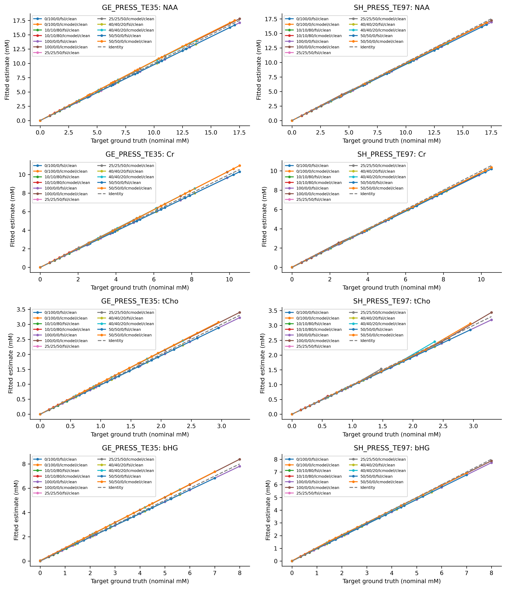
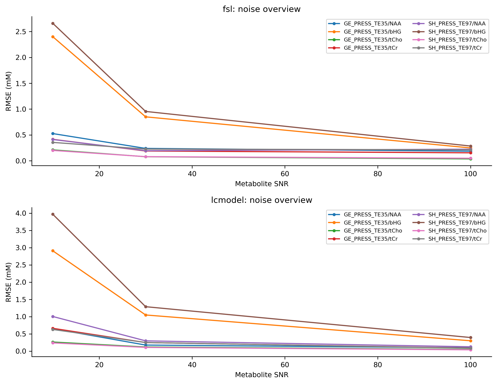
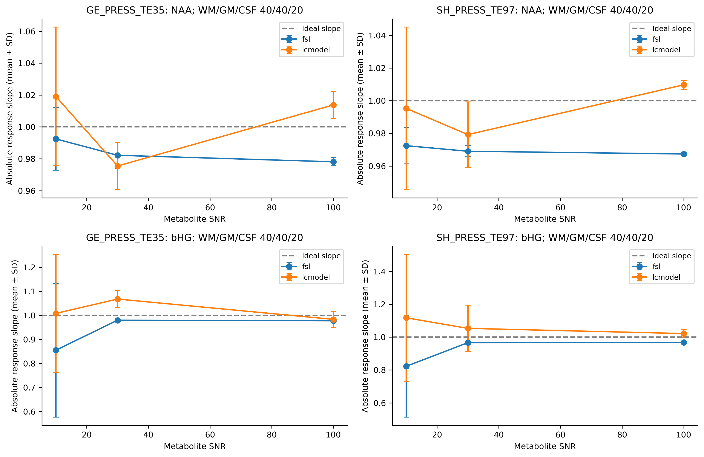
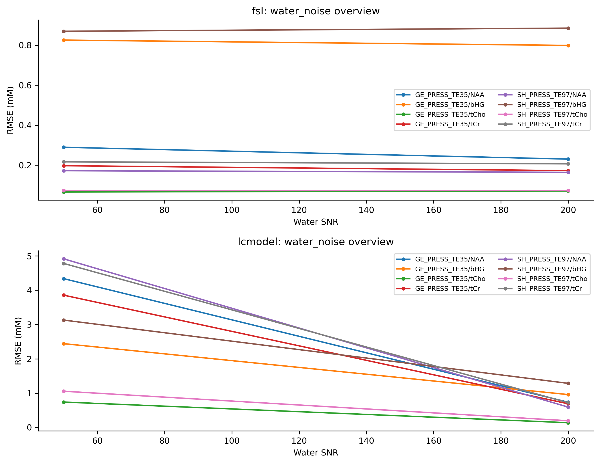

# Headless water reference validation results

The notebook's approximate BASIS-H2O workflow tracks known concentration changes closely in noiseless matched-BASIS experiments. Both fitters show stable scale differences rather than loss of concentration sensitivity. Noise reduces precision, and strong shim/noise stress can cause large errors or quantification failure. These results characterize the declared nominal-mM simulation and fitting pipelines; they do not establish physical scanner calibration.

## Study and reproducibility

The completed study generated **1,312 acquisitions** and attempted **2,624 fits**, using FSL-MRS 2.5.1.dev78+ga311e38f2 and the installed LCModel executable. All case/fitter pairs are accounted for. Generation and fitting source hashes, BASIS identities, and environment versions are preserved in the [results directory](../research/validation/headless_water/results/manifest.json). No production simulator equations, original notebook code/results, or source BASIS files changed. No fitted amplitude corrections were applied.

[Methods and reproduction commands](../research/validation/headless_water/README.md) describe the exact matrix, concentration conventions, fixed PCr reference for FSL-MRS, and LCModel controls. The detailed bases are GE PRESS TE35 and SH PRESS TE97. Ten other bases receive smaller transfer checks. Clean experiments exclude added legacy decay and nuisance signals; anatomical and realism checks are separate. Noise conditions use ten paired realizations, one controlled spatial field pattern, and fixed tissue arrangements.

The original simulator's archived-source regression, deterministic generation, name matching, native water-profile linearity, residual-water independence and complex export/reload checks pass. The complete automated suite and added report checks total **51 passing tests**. Existing scientific caveats about nominal units, encoded proton counts, legacy T2 and time origin remain in force.

## Water formation and concentration truth

Across **1278 controlled acquisitions**, independently reconstructed complex water agrees with simulated water to a maximum relative error of **1.19e-07**. Recomputed voxel concentrations have maximum absolute error **0 mM**; tissue-weighted nominal water has maximum error **0 mol/L**. Each BASIS uses one fixed normalization scalar throughout.

All **42 noise-condition groups** preserve identical clean signals across repeats while producing distinct noise draws. Controlled B0 SD matches requested settings. Anatomical confirmation uses measured B0 SD approximately **3.0197 Hz**, rather than the controlled-design placeholder of zero.

Matched reference/declared-water scaling by 0.5, 1 and 2 leaves metabolite estimates unchanged; a deliberately doubled reference without the matching water-concentration declaration approximately halves them. These are downstream scaling controls; native generator concentration linearity is verified separately using changed generator water profiles.

| basis_name | fitter | water_factor | mismatched | truth_mM | estimate_mM | status |
| --- | --- | --- | --- | --- | --- | --- |
| GE_PRESS_TE35 | fsl | 0.5 | False | 6.836 | 6.674 | ok |
| GE_PRESS_TE35 | fsl | 1 | False | 6.836 | 6.674 | ok |
| GE_PRESS_TE35 | fsl | 2 | True | 6.836 | 3.337 | ok |
| GE_PRESS_TE35 | fsl | 2 | False | 6.836 | 6.674 | ok |
| GE_PRESS_TE35 | lcmodel | 0.5 | False | 6.836 | 7.113 | ok |
| GE_PRESS_TE35 | lcmodel | 1 | False | 6.836 | 7.113 | ok |
| GE_PRESS_TE35 | lcmodel | 2 | True | 6.836 | 3.556 | ok |
| GE_PRESS_TE35 | lcmodel | 2 | False | 6.836 | 7.113 | ok |
| SH_PRESS_TE97 | fsl | 0.5 | False | 6.836 | 6.608 | ok |
| SH_PRESS_TE97 | fsl | 1 | False | 6.836 | 6.608 | ok |
| SH_PRESS_TE97 | fsl | 2 | True | 6.836 | 3.304 | ok |
| SH_PRESS_TE97 | fsl | 2 | False | 6.836 | 6.608 | ok |
| SH_PRESS_TE97 | lcmodel | 0.5 | False | 6.836 | 6.762 | ok |
| SH_PRESS_TE97 | lcmodel | 1 | False | 6.836 | 6.762 | ok |
| SH_PRESS_TE97 | lcmodel | 2 | True | 6.836 | 3.381 | ok |
| SH_PRESS_TE97 | lcmodel | 2 | False | 6.836 | 6.762 | ok |

## Primary noiseless sensitivity

Each row below summarizes 42 complete responses: seven targets across six nonempty tissue mixtures, with seven concentration levels from zero to twice baseline. Primary truth is voxel-average nominal mM; no CSF tissue-only correction is silently compared against that target. Pure CSF is a separate boundary case. R² describes linearity, not absence of bias. Fold-change error compares against each response's own baseline without correcting raw estimates.

| basis_name | fitter | responses | slope_min | slope_max | minimum_R2 | max_fold_RMSE |
| --- | --- | --- | --- | --- | --- | --- |
| GE_PRESS_TE35 | fsl | 42 | 0.9763 | 0.9764 | 1 | 2.061e-05 |
| GE_PRESS_TE35 | lcmodel | 42 | 1.016 | 1.048 | 0.9998 | 0.01707 |
| SH_PRESS_TE97 | fsl | 42 | 0.9666 | 0.9666 | 1 | 1.163e-05 |
| SH_PRESS_TE97 | lcmodel | 42 | 0.9712 | 1.03 | 0.9978 | 0.04499 |

[Paired signed-error plots](../research/validation/headless_water/results/target_residual.pdf) show fitted minus ground truth in mM against ground-truth concentration, using the same panels and curves with a zero-error reference. Per-basis `target_residual_<basis>` PDF/PNG files accompany the overview.

[All response slopes and intercepts](../research/validation/headless_water/results/response_slopes.csv) retain metabolite- and tissue-specific results. [Fold-change plots](../research/validation/headless_water/results/fold_response.pdf) distinguish sensitivity from absolute scale. tNAA/tCr/tCho are sums of individual estimates, with no independence assumption for grouped uncertainty.

The smaller transfer experiment gives the following descriptive ranges; its three concentration levels provide less stringent evidence than the detailed seven-level sweeps.

| fitter | responses | slope_min | slope_max | minimum_R2 |
| --- | --- | --- | --- | --- |
| fsl | 20 | 0.963 | 0.9764 | 1 |
| lcmodel | 20 | 0.9473 | 1.039 | 1 |

## Noise and shim robustness

For baseline NAA in the 40/40/20 WM/GM/CSF mixture, empirical precision is:

| basis_name | fitter | snr | n | bias_mM | SD_mM |
| --- | --- | --- | --- | --- | --- |
| GE_PRESS_TE35 | fsl | 10 | 10 | -0.1753 | 0.4758 |
| GE_PRESS_TE35 | fsl | 30 | 10 | -0.1626 | 0.1527 |
| GE_PRESS_TE35 | fsl | 100 | 10 | -0.1617 | 0.04546 |
| GE_PRESS_TE35 | lcmodel | 10 | 10 | 0.4512 | 0.4129 |
| GE_PRESS_TE35 | lcmodel | 30 | 10 | 0.0076 | 0.163 |
| GE_PRESS_TE35 | lcmodel | 100 | 10 | 0.0584 | 0.07436 |
| SH_PRESS_TE97 | fsl | 10 | 10 | 0.09881 | 0.3901 |
| SH_PRESS_TE97 | fsl | 30 | 10 | -0.1237 | 0.127 |
| SH_PRESS_TE97 | fsl | 100 | 10 | -0.1974 | 0.03864 |
| SH_PRESS_TE97 | lcmodel | 10 | 10 | 0.6392 | 0.7005 |
| SH_PRESS_TE97 | lcmodel | 30 | 10 | 0.0552 | 0.2846 |
| SH_PRESS_TE97 | lcmodel | 100 | 10 | 0.0718 | 0.1013 |

[Paired stressed-response slopes](../research/validation/headless_water/results/robust_response_summary.csv) evaluate 0.5/1/1.5 concentration levels with the same seed at each level. Slopes require all three successful levels; missing baselines and failed fits are counted as incomplete responses. Mean and SD across ten repeats are descriptive screening statistics.

Increasing B0 dispersion does not worsen every estimate monotonically: the fitters can model some broadening. Strong stress produces metabolite-specific bias and failures. [Shim error tables](../research/validation/headless_water/results/shim_errors.csv) and [plots](../research/validation/headless_water/results/shim_rmse.pdf) preserve the full pattern. B0 SD is not a fitted linewidth; measured water magnitude-spectrum FWHM is recorded separately in the full acquisition checks.

## Independent reference noise and anatomical confirmation

The forty reference-noise acquisitions have exactly the same complex metabolite samples as their paired clean-water controls (metabolite SNR 30, identical seed). The following table therefore isolates changes caused by the water-reference pipeline. Values are noisy-water estimates minus estimates with clean water; the underlying truth and metabolite noise are unchanged.

| basis_name | fitter | metabolite | water_snr | n | mean_delta_mM | sd_delta_mM | rmse_delta_mM |
| --- | --- | --- | --- | --- | --- | --- | --- |
| GE_PRESS_TE35 | fsl | NAA | 50 | 10 | 0.04418 | 0.1466 | 0.146 |
| GE_PRESS_TE35 | fsl | NAA | 200 | 10 | 0.009643 | 0.03705 | 0.03645 |
| GE_PRESS_TE35 | lcmodel | NAA | 50 | 10 | 1.96 | 4.03 | 4.296 |
| GE_PRESS_TE35 | lcmodel | NAA | 200 | 10 | 0.1257 | 0.7252 | 0.6994 |
| SH_PRESS_TE97 | fsl | NAA | 50 | 10 | 0.03498 | 0.1314 | 0.1295 |
| SH_PRESS_TE97 | fsl | NAA | 200 | 10 | 0.007367 | 0.0328 | 0.03198 |
| SH_PRESS_TE97 | lcmodel | NAA | 50 | 10 | 2.447 | 4.62 | 5.019 |
| SH_PRESS_TE97 | lcmodel | NAA | 200 | 10 | 0.1156 | 0.7079 | 0.6814 |

LCModel is substantially more sensitive to the tested noisy references: at water SNR 50 the paired NAA-change RMSE is approximately 4.30 mM for GE35 and 5.02 mM for SH97, versus 0.146 and 0.129 mM for FSL-MRS. This is an important limitation of the tested scaling protocol, even though fits return finite estimates. It is not evidence of a failure of noiseless tissue-weighted signal formation. The cause has not been isolated; these runs do not justify a general claim about LCModel or an empirical correction. Nominal water SNR is a spectral-peak definition, not an interchangeable scanner/vendor SNR measure.

Actual MRiLab confirmation covers three selected voxels and five baseline/concentration conditions per voxel, giving 15 cases per detailed BASIS. For NAA the errors pooled over these conditions are:

| basis_name | fitter | n | bias_mM | RMSE_mM |
| --- | --- | --- | --- | --- |
| GE_PRESS_TE35 | fsl | 15 | -0.1508 | 0.1607 |
| GE_PRESS_TE35 | lcmodel | 15 | -0.01396 | 0.05297 |
| SH_PRESS_TE97 | fsl | 15 | -0.2551 | 0.2685 |
| SH_PRESS_TE97 | lcmodel | 15 | -0.2431 | 0.2682 |

The additional two realism conditions restore legacy T2 alone and then add MM/lipids/residual water. Their NAA readouts are below; `realistic=False` still has legacy T2 enabled. These are descriptive mismatch checks, not a replicated realism-accuracy claim.

| basis_name | fitter | realistic | truth_mM | estimate_mM | error_mM |
| --- | --- | --- | --- | --- | --- |
| GE_PRESS_TE35 | fsl | False | 6.972 | 6.893 | -0.07882 |
| GE_PRESS_TE35 | fsl | True | 6.972 | 7.608 | 0.6363 |
| GE_PRESS_TE35 | lcmodel | False | 6.972 | 6.92 | -0.05214 |
| GE_PRESS_TE35 | lcmodel | True | 6.972 | 7.257 | 0.2849 |
| SH_PRESS_TE97 | fsl | False | 6.972 | 6.798 | -0.1743 |
| SH_PRESS_TE97 | fsl | True | 6.972 | 6.894 | -0.07781 |
| SH_PRESS_TE97 | lcmodel | False | 6.972 | 6.64 | -0.3321 |
| SH_PRESS_TE97 | lcmodel | True | 6.972 | 6.669 | -0.3031 |

## Failures and scope of conclusions

Native fitter outcomes are:

| fitter | failed | ok | optimizer_warning |
| --- | --- | --- | --- |
| fsl | 38 | 1273 | 1 |
| lcmodel | 2 | 1310 | 0 |

There are **40 failed case/fitter pairs**. Pure-CSF failures are expected because no metabolite reference is present. Additional FSL-MRS stress failures occur when fitted PCr reaches zero or becomes unusable for water quantification despite nonzero truth. The protocol was kept fixed; no reference switching was used to rescue individual outcomes. Optimizer-warning fits with finite concentrations remain in summaries and are flagged in the native status table. Accuracy statistics exclude failed estimates, so their failure counts must be considered alongside error bars.

[Per-stage outcomes](../research/validation/headless_water/results/fit_outcomes.csv) distinguish boundaries and stress conditions. [Native status records](../research/validation/headless_water/results/fitter_status.csv) preserve error messages. Anatomical/realism results, all individual estimates, off-target cross-talk and native fitter reports remain in the [full local study output](../outputs/headless_water_validation/report.md).

The main supported conclusion is noiseless concentration sensitivity under matched BASIS assumptions and correctly declared water content. Robustness conclusions are limited to the tested noise seeds, spatial field, tissue arrangements, selected anatomical voxels and fitter settings. Legacy T2/MM/lipid/residual-water experiments deliberately introduce model mismatch; they are not evidence of validated relaxation correction. Ten repeats do not establish precise failure probabilities. The two fitters also use different baseline models, so their differences cannot be attributed uniquely to the simulator.

The generated acquisition audit supersedes the generation-time water-SNR bookkeeping field by measuring clean/noisy reference pairs and retaining the actual native applied noise SD. This correction changes reported diagnostics, not signal amplitudes or fits.

