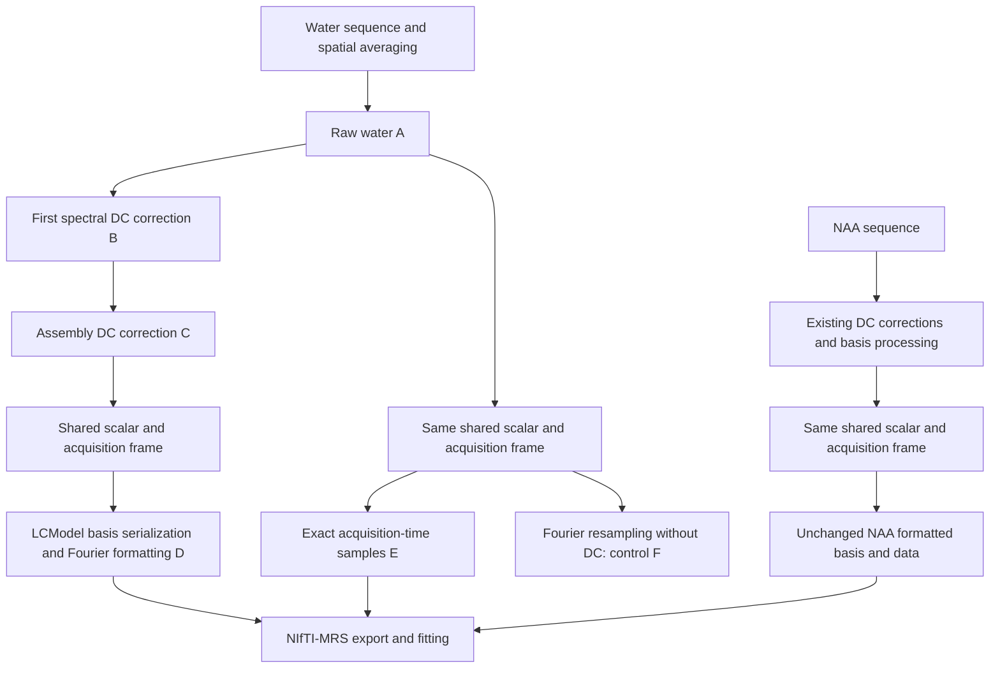

# Phase 5f: preserving sequence-matched water through processing

## Finding and recommendation

The first MRSCloud DC correction, not RF simulation or an unexplained
two-proton factor, creates the approximately half-sized first sample. The
second DC correction changes its complex phase slightly. FSL's Fourier basis
resampling then changes early samples and introduces ringing. Ordinary FFT /
IFFT round trips and NIfTI-MRS export are not responsible for the large loss.

For this known single-resonance simulation, the preferred acquisition pathway
is **E: capture the raw sequence response before basis DC corrections, retain
the same shared scalar, express it in the acquisition frame, and evaluate it
on the desired acquisition time grid**. Here the grid is an exact integer
subset of the native readout, so every retained sample, including sample zero,
is preserved exactly. Do not repair an already processed sample by multiplying
it by two. No such repair or new calibration constant was used.

The raw target-grid water fits with relative complex residual **1.44416e-7**,
versus **0.0284771** for the Phase 5e basis-processing path. This validates a
standalone synthetic water-processing convention. It does not establish
physical scanner calibration or resolve the remaining metabolite-basis
representation and tissue/relaxation quantification questions.

## Direct capture and source integrity

`examples/capture_water_processing.m` instruments a private copy of the bundled
`sim_signals.m` in the experiment's output folder. It renames the copied main
function and inserts a save immediately before `op_dccorr_FID_A`. The three
possible sequence branches are guarded explicitly; only UnEdited PRESS runs.
No sequence operation is removed or changed, and no bundled source is edited.
The raw capture is after density-matrix readout, spatial averaging and voxel/FOV
scaling, and before spectral DC correction.

Both pre- and post-DC arrays are saved from the **same simulation**. The new
post-DC capture equals the Phase 5e on-carrier water array exactly: maximum
complex difference **0**. The original simulator SHA-256 remains
`3ea6d9a18a0991183a483f5315fedae5397e74f5ab9463da303d985ab6595bd9`.
Source integrity is also checked around the automated Octave fixture.

The sequence remains Universal_Philips unedited PRESS, TE=30 ms (14+16 ms),
ideal 90° excitation, shaped 7 ms refocusing, water RF carrier 4.7 ppm, 101
points per refocusing direction, native 8192 points at 4000 Hz, linewidth 1 Hz.
The original NAA acquisition remains at RF=3 ppm. No RF waveform, spin-system
definition, current synthetic calibration or Phase 5e output was changed.

## Processing chain



All measurements use one Phase 5e reference scalar **2779.198340948381**.
It is read from saved provenance and is never recalculated using a water
variant. Native variants A/B/C use 8192 points / 4000 Hz; D/E/F use 2048
points / 2000 Hz. All are shifted to the same 4.68 ppm acquisition frame:
water frequency +2.55462 Hz, with no additional phase adjustment.

The NAA response is held fixed within each grid. In the exported comparison,
D and E use array-identical metabolite data and the same unmodified matching
Phase 5e basis file. There is no new maximum, norm or water-specific gain.

## Source functions and effects

MRSCloud paths below are under `simulation/basissets/MRSCloud-main/functions/`.

| Operation / source | Effect on samples and relative response | Water-acquisition assessment |
|---|---|---|
| `sim_signals.m`, `sim_readout.m` | Coherent pulse/sequence response, receiver phase, spatial scaling, 1 Hz readout decay; decay starts at unity | Retain: this is the simulated response |
| `FID-A/processingTools/op_dccorr_FID_A.m` | Estimates a complex edge-spectrum constant on `fftshift(ifft(FID))`; subtracting it changes only sample zero by N times that constant; first phase and areas change | Bypass for noiseless water acquisition: there is no added receiver DC offset to remove |
| `osprey_functions/fit_makeBasis_MRSCloud.m` and `FID-A/processingTools/op_dccorr.m` | Recompute forward FFT and subtract another edge constant; IFFT changes only sample zero; can change first phase and real-spectrum area | Preserve in the existing basis representation; bypass for raw water |
| Common assembly maximum | Divides every complex sample by the same recorded scalar; preserves all relative raw responses | Retain identically for NAA and every water variant |
| Export acquisition-frame mixing | Unit-magnitude frequency shift; changes phase evolution, not magnitude or sample zero | Retain; distinct from changing RF carrier |
| `io_writelcmBASIS.m` / equivalent Phase 5e writer | FFT/conjugation/serialization; six-digit precision gives small rounding differences | Basis-specific file representation; water acquisition need not pass through a BASIS file |
| FSL `core/basis.py::_calculate_resampled_basis`, `utils/misc.py::ts_to_ts_ft` | Crops/pads the spectrum, IFFTs, applies FFT-length scaling, then truncates time; this is filtering, not exact evaluation at original times | Bypass for this synthetic water acquisition; it changes the causal record boundary and first samples |
| Proposed integer acquisition-time selection | Selects existing time samples exactly; no multiplier or interpolation | Appropriate for this grid and narrow synthetic line; rerun ADC readout at target dwell for general grids |
| `gen_nifti_mrs` and FSL reader | Stored conjugation is reversed on interpretation; complex arrays preserved | Retain the validated convention |
| FSL `FIDToSpec` | Half-weights the first point for spectral analysis and restores the input; uses orthonormal FFT | Analysis convention, not a persistent change to the input FID |

The paired inverse FFT conventions are algebraically consistent: a no-DC
FFT/IFFT round trip has maximum complex error **7.299929454022716e-16** in
native raw units. It does not halve the first point. The half-sized sample
arises specifically from subtracting the estimated spectral background.

## Independent isolation of the first-point effect

For first correction spectral constant delta_1 and native N,

\[
x_B[n]=x_A[n]-N\,\delta_1\,\mathbf{1}_{n=0}.
\]

For assembly forward-spectrum constant delta_2,

\[
x_C[n]=x_B[n]-\delta_2\,\mathbf{1}_{n=0}.
\]

The difference in N factors follows the opposite FFT normalizations used by
the two routines. Tests independently calculate the edge estimates and both
transforms; they compare the complete complex arrays and verify that later
samples are unchanged to roundoff. No fixed half-point factor is assumed.

Native pre-normalization values from the actual capture are:

- Raw sample zero: **1.7906781867670487 + 1.07321e-16i**.
- After first DC: **0.8964257146226227 − 0.0001715488248337854i**.
- Later samples retain the exact 1 Hz exponential and extrapolate back to the
  raw sample, not the DC-corrected first sample.
- Second correction delta_2 is approximately
  **1.78047e-15 − 0.0003430976496685799i**. It changes the small first-sample
  phase while leaving the approximately half-sized magnitude essentially
  unchanged; it is not responsible for the original factor-of-two appearance.

The coefficient of the first-point loss depends on the record, line shape,
frequency and edge estimator. In short fixtures it is not universally one half.
This is why an empirical multiply-by-two repair would be incorrect.

The independent FSL first-point-weighting test also confirms that `FIDToSpec`
returns an input-identical FID after its temporary half-weighting. Its resulting
spectrum differs from an unweighted spectrum by the expected constant
−x[0]/(2*sqrt(N)). That changes spectral integration, not stored input samples.

## Controlled variants and amplitudes

Numbers below are on the same unit-concentration response scale after dividing
by the fixed scalar; they are SRU per nominal mol/L. Native A/B/C and target-grid
D/E/F comparisons use raw responses at their respective exact time samples.

| Variant | Initial complex sample | Tail-extrapolated initial magnitude | Max complex difference from raw on same grid |
|---|---|---:|---:|
| A: raw, no DC | .000644314642961392 + approximately 0i | .000644314642961400 | 0 |
| B: first DC | .000322548305176637 − 6.17260101e-8i | .000644314642961400 | .000321766343705356 |
| C: both DC | .000322548305176637 + 6.17260101e-8i | .000644314642961400 | .000321766343705356 |
| D: both DC + BASIS/formatting | .000322302422485938 + 7.38755164e-7i | .000644313358309814 | .000322013067894339 |
| E: raw on acquisition grid | .000644314642961392 + approximately 0i | .000644314642961392 | **0** |
| F: raw + Fourier formatting, no DC | .000483185595297950 + 7.07889175e-7i | .000644313362399676 | .000161130602642735 |

Tail extrapolation uses a log-magnitude/phase regression over .05–.5 s;
short test records fall back to available samples after sample zero. Tail
frequency remains approximately 2.55462 Hz and linewidth approximately 1 Hz.
Exact frequency, linewidth and initial phase for every variant are in the CSV
and JSON. Initial phases are respectively approximately 0, −.000191370,
+.000191370, .002292114, 0, and .001465045 rad.

Control F demonstrates that bypassing DC **alone** is insufficient when a
Fourier crop is subsequently used as an acquisition sampler. Cropping the
frequency-domain representation of a finite causal FID filters its initial
boundary; its first sample and early ringing change even though the FFT-length
scaling correctly preserves the intended spectral normalization. The effect
is not explained by an incorrect global factor in resampling.

Direct target-grid sampling in E preserves sample zero and all coincident
native samples exactly, maximum error **0**. It is not a numerical repair of D;
it uses the independently captured pre-DC response. The existing BASIS file's
serialization plus Fourier formatting matches direct application of the FSL
formatter to C to relative difference **5.96931e-8**, consistent with BASIS
rounding. Thus a large additional export gain error is excluded.

## Spectral areas and amplitude ratios

FSL-compatible raw-data integral is trapz(abs(real(orthonormal FFT with
first-point half-weighting))) over 1.65–7.65 ppm. Fitted water integrals below
are after the handler's fitted frequency/phase correction. These are distinct
quantities even for an excellent fit; see Phase 5b.1.

| Variant | Data integral per mol/L | Fitted integration-model integral per mol/L | Initial water/NAA magnitude ratio |
|---|---:|---:|---:|
| A | .02914004980 | .02917274922 | .6976892064 |
| B | .03094035967 | .02915519840 | .3492679821 |
| C | .03094035967 | .02915519858 | .3492679821 |
| D | .01584157110 | .01518037833 | .3466194706 |
| E | .01462568655 | .01519388338 | .6929250238 |
| F | .01482497715 | .01519000206 | .5196401371 |

Native versus target-grid integral numbers cannot be compared as physical
amplitude loss without accounting for orthonormal FFT size, bin spacing,
integration window and record duration. The corresponding metabolite and water
integrals use the same grid in quantification. A/B/C comparisons within one
grid and D/E/F comparisons within their grid isolate processing effects.

The first-sample water/metabolite ratio changes because first-point processing
changes representations differently. That does **not** mean a different shared
gain or proton count was introduced. Common normalization, sequence response,
processing transformation and FSL's tissue/relaxation model are separate.
Neither instantaneous sample-zero ratios nor spectral peak heights should be
treated as a universal proton-response calibration.

## Water fitting and actual CLI validation

All six variants were fitted using the installed, unmodified FSL-MRS WaterRef
routine and its default initialization/bounds. No fitted concentration or
water-amplitude target changes a signal. Original-scale fitted amplitudes here
correspond to **40 mol/L water**, not the unit responses in the earlier table.

| Variant | Fitted amplitude | Frequency Hz | Phase rad | FWHM Hz | Full complex relative residual |
|---|---:|---:|---:|---:|---:|
| A | .0257725737205 | 2.5546201099 | −9.07e-8 | .9999983277 | **4.270996e-7** |
| B | .0257573392226 | 2.5546208816 | 1.42675e-6 | .9988097783 | **.0197759724** |
| C | .0257573393740 | 2.5546207447 | 1.65606e-6 | .9988097878 | **.0197759725** |
| D | .0257499620867 | 2.5545810585 | 3.55538e-5 | .9982039705 | **.0284770893** |
| E | .0257725851457 | 2.5546201459 | −1.43406e-7 | .9999999373 | **1.444162e-7** |
| F | .0257658325093 | 2.5546016335 | 1.64595e-5 | .9994998735 | **.0149410048** |

Every optimizer reported success; the full residuals, not success alone,
identify the poor model matches. E's expected 40 M raw amplitude is
**.025772585718455672**. It was preserved from the sequence simulation without
an empirical factor or independent normalization.

Actual CLI fitting with `--report` was performed for D and E, using the same
fixed NAA data and basis, Newton/Lorentzian fitting, disabled baseline,
NAA-only .2–4.2 ppm, TE 30 ms, TR 2 s and pure-WM standard quantification:

- [D: basis-processed water report](../outputs/mrscloud_water_processing/final/D_DC_and_Fourier_resampling/fsl_mrs_results/report.html)
- [E: raw acquisition water report](../outputs/mrscloud_water_processing/final/E_raw_acquisition_grid/fsl_mrs_results/report.html)

Both CLI processes completed successfully and produced nonempty HTML reports.
The exported interpreted water arrays differ from their supplied inputs by
**0** at default precision. Metabolite data differ by **0**. The CLI raw NAA
coefficient is **.01000000076436493** for both cases, consistent with the 10 mM
concentration and matching unit-concentration basis; there is no change in
metabolite fitting caused by bypassing water basis processing.

Standard FSL molarity is **6.891917170702524 mM** for D and
**6.885791303512254 mM** for E. Improved water model fidelity does not force
the result to 10 mM. FSL's tissue densities, TE/TR relaxation assumptions and
NAA/water integration/proton convention remain as derived in Phase 5d.1.
The modest concentration difference reflects the fitted integration-area
change, not a new calibration choice. No standard quantifier correction was
applied.


The early-time plots express **both data and model per mol/L**, undoing the
known 40 M concentration and MRS fitting scale for display. Fit diagnostics
remain in original acquisition units. No curve is fitted or independently
normalized just to make these plots agree. The CLI HTML can still show the
known original-versus-integration reference-frame displacement; the diagnostic
plots compare the true model and data in the same frame.

## Preferred convention and quantitative scope

For a noiseless simulated unsuppressed water acquisition, bypass both
`op_dccorr_FID_A` and assembly `op_dccorr`; there is no receiver DC offset in
this signal. Do not route water through LCModel basis serialization/formatting
as if it were an additional basis column. Retain its raw sequence amplitude,
the common scalar, and the documented acquisition-frame transformation. Sample
at the desired ADC times. For this 4000→2000 Hz case, selecting samples 0,2,4,…
is exactly evaluation of the same readout at those times. For general grids,
evaluate `sim_readout` on the target grid rather than inventing first-point
repairs or unrecorded filter normalization.

This recommendation is scoped to the narrow single-resonance model. Integer
sampling is not a general antialiasing prescription for arbitrary broadband
FID data, and real ADC filtering has not been modeled. No new filter should be
introduced without specifying its transfer function and amplitude behavior.

The existing processed NAA basis and its matching synthetic metabolite data
remain fixed. Their coefficient interpretation is unchanged, and both paths
retain the same raw sequence-response scalar. Basis processing can continue
as a fitting representation, while acquired water is represented as an
undistorted FID. However, this does not prove that every basis-specific
metabolite transform represents a physical acquisition. Future raw-metabolite
simulation and physical scaling work must explicitly review that distinction;
it must not be concealed with separate water/metabolite gain factors.

## Reproduction and tests

Files added: `examples/capture_water_processing.m`,
`examples/mrscloud_water_processing_validation.py`,
`tests/integration/test_mrscloud_water_processing.py`, and this document.
No existing experiment, source or calibration file was edited.

Executed commands included:

```
pixi run octave --no-gui --quiet --eval "addpath('examples'); capture_water_processing('outputs/mrscloud_water_processing/octave',101,8192);"
pixi run python -m examples.mrscloud_water_processing_validation outputs/mrscloud_water_processing --reuse-capture
pixi run python -m examples.mrscloud_water_processing_validation outputs/mrscloud_water_processing/validated
pixi run python -m examples.mrscloud_water_processing_validation outputs/mrscloud_water_processing/final
pixi run python -m pytest -q tests/integration/test_mrscloud_water_processing.py
pixi run python -m pytest -q tests
```

Use a fresh output directory to reproduce. The driver invokes configured
Pixi/Octave and the real CLI, saving exact Octave and FSL command lines and
stdout/stderr. The two CLI commands, including the unchanged Phase 5e matching
basis path and all quantification flags, are in
`outputs/mrscloud_water_processing/final/cli_commands.txt`.

The authoritative final directory contains the captured pre-/post-DC MAT
files and instrumented private source copy, six variants as NPZ arrays,
comparison.csv, results.json, two figures and two complete CLI result folders
with their actual report.html files. Earlier directories retain intermediate
outputs; Phase 5e artifacts are read-only inputs and remain untouched.

The focused tests passed **6 tests**: direct raw capture/source integrity,
independent DC/FFT calculations, sample-zero isolation, temporary FSL weighting,
independent Fourier cropping, exact acquisition-grid sampling, compatible raw
water fitting and rejection of unsupported target grids. The full suite
completed with **82 passed, 1 xfailed**, zero unexpected failures, in 58.36 s.
The expected failure remains the known installed-package combined frequency/
phase initialization defect; five existing dependency warnings were emitted.
Tests use a small 3-point/256-readout
capture; the reported experiment uses 101-point/8192-readout simulation.

Octave's known bundled-code deprecation/load-path/shadowing and shutdown
messages are retained in logs. An initial capture guard expected one textual
DC call; source inspection showed three sequence branches, and the private
instrumentation guard was corrected accordingly before successful capture.
No source behavior was changed to make a test or concentration pass.

Remaining limitations are the ideal excitation/two-direction localization of
the bundled PRESS implementation, historical basis provenance, first-point
conventions in metabolite representation, the Hamiltonian/export gyromagnetic
constant inconsistency, real acquisition filtering, and physical molar/scanner
calibration. Production integration, calibration changes and LCModel work are
deferred.
